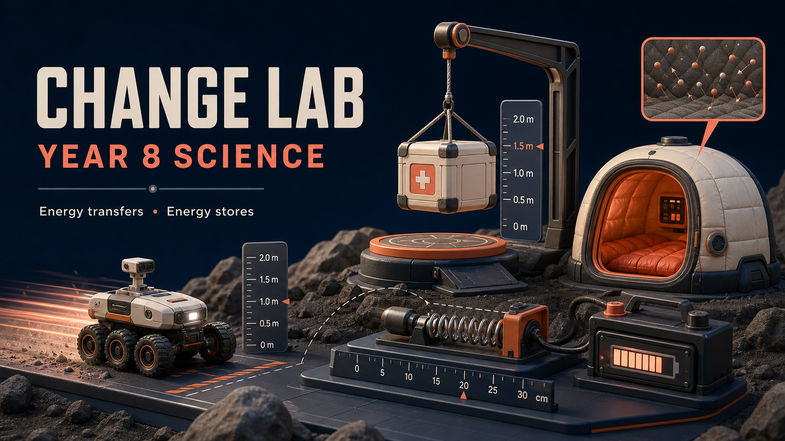

# ChangeLab — Year 8 Science

ChangeLab is an interactive simulation website for the NSW Year 8 Science topic **Change**. It helps students investigate scientific systems by changing variables and observing visual evidence rather than completing worksheet-style questions.

**Student website:** [irvincisneros-png.github.io/changelab-year-8-science](https://irvincisneros-png.github.io/changelab-year-8-science/)



## Simulations

### 7.1.1 — Heat transfer

Four interactive missions explore:

- conduction through solids
- convection in moving fluids
- radiation through space
- a mixed polar-rescue challenge combining all three transfer pathways

### 7.1.2 — Energy stores

Six evidence-led missions explore:

- kinetic energy stores
- gravitational potential energy stores
- elastic potential energy stores
- thermal energy stores
- chemical potential energy stores
- a mixed Energy Vault classification challenge

The models use relative comparison values so Year 8 students can focus on patterns before formal calculations.

## Learning and access design

- Lexend typography and scalable interface text
- mission hooks and goal briefings for every scenario
- motion, system-boundary and particle evidence lenses
- light, dark and system themes
- reduced-motion support
- sound effects and optional Mr. Cisneros narration
- responsive layouts for classroom laptops and smaller screens
- scientifically careful distinction between energy stores and transfer pathways

## Run locally

Requires Node.js 22.13 or later.

```bash
npm install
npm run dev
```

Then open `http://localhost:3000`.

## Validation

```bash
npm test
npm run lint
```

The test suite covers the energy-store model, scientific guardrails, server-rendered routes and packaged media assets.

## Technology

- Next.js and React
- Vinext/Vite for the Cloudflare-compatible build
- CSS Modules and Web Audio
- Fish Audio narration assets

## Classroom use

ChangeLab is designed as a simulation environment rather than a worksheet replacement. Teachers can pair it with their own discussion prompts, practical work and assessment resources.
